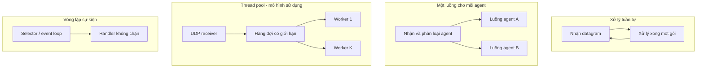
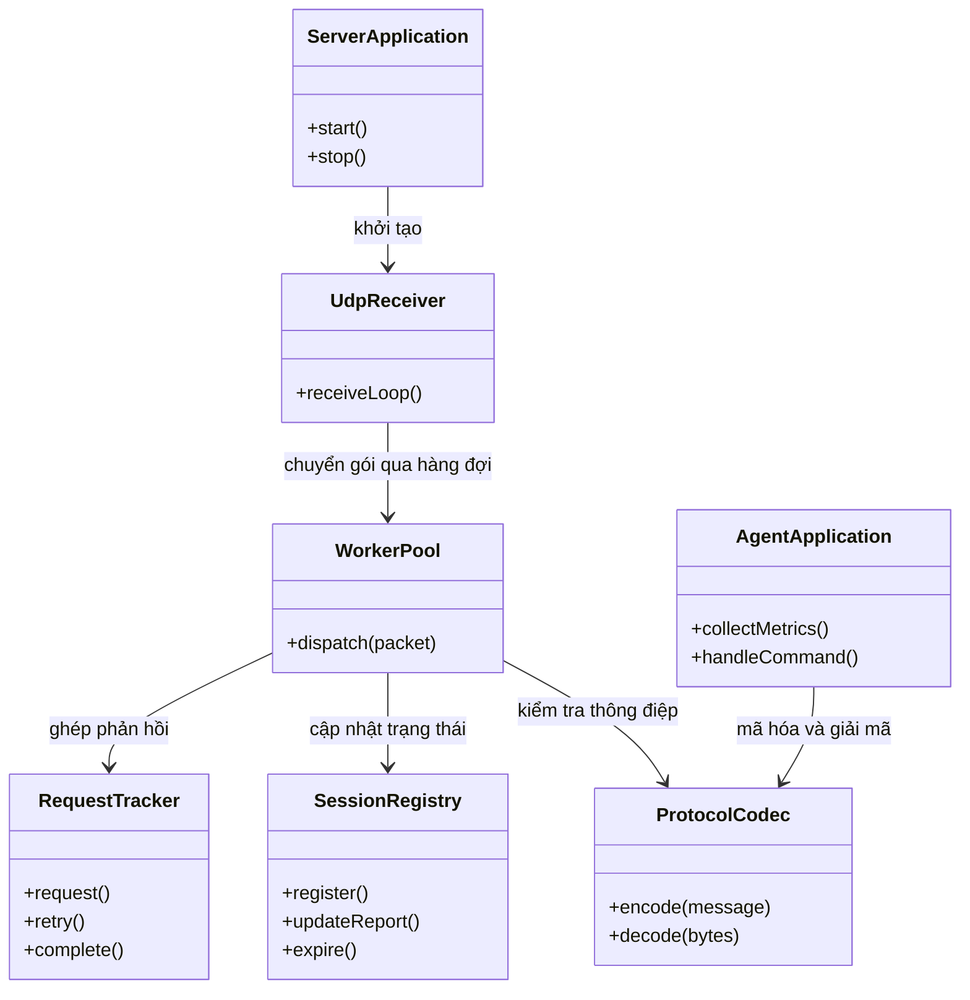
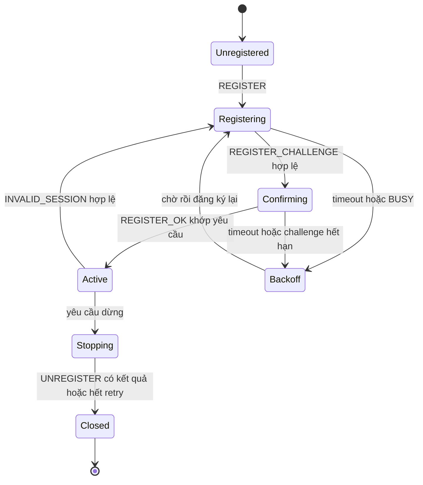

# Kiến trúc hệ thống giám sát LAN qua UDP

Phiên bản thiết kế: 1.0 — 15/10/2026. Giao thức sử dụng: [LANMON/1 trên UDP](protocol-design.md). Phạm vi hệ thống được trình bày trong [đề xuất đề tài](proposal.md).

## 1. Mô hình đồng thời

Máy chủ sử dụng mô hình **thread pool kết hợp Producer–Consumer**. Một luồng nhận datagram UDP và đưa vào hàng đợi có giới hạn. Các worker lấy gói từ hàng đợi để xác thực, kiểm tra phiên và cập nhật trạng thái máy. Luồng gửi riêng xử lý các phản hồi và yêu cầu điều khiển agent.

| Mô hình | Cách hoạt động | Ưu điểm | Nhược điểm | Công cụ điển hình |
|---|---|---|---|---|
| Một luồng cho mỗi agent | Phân loại datagram theo agent rồi giao cho luồng riêng | Tách xử lý giữa các agent | Số luồng tăng theo số agent; UDP không có kết nối để gắn trực tiếp với luồng | Java Thread |
| Thread pool | Worker cố định nhận tác vụ từ hàng đợi | Giới hạn số luồng và tài nguyên; nhận gói độc lập với xử lý | Cần bảo vệ trạng thái dùng chung và xử lý gói sai thứ tự | ExecutorService, ArrayBlockingQueue |
| Vòng lặp sự kiện / I/O bất đồng bộ | Điều phối socket không chặn trong vòng lặp sự kiện | Phục vụ nhiều socket với ít luồng | Tác vụ chặn ảnh hưởng vòng lặp; cách tổ chức phức tạp hơn | DatagramChannel, Selector |

**Mô hình của hệ thống:** thread pool với 4 worker và hàng đợi nhận 1.024 gói. Lựa chọn này phù hợp với mục tiêu thử nghiệm 10–100 agent, đồng thời cho phép khảo sát ảnh hưởng của số worker khi đo tải. Khi hàng đợi đầy, receiver bỏ gói mới và tăng bộ đếm; không chờ worker hoặc tạo thêm luồng. Agent và server đều dùng hàng đợi gửi có giới hạn 1.024 gói.

Server có luồng nhận, luồng gửi, nhóm worker, bộ lập lịch kiểm tra timeout và luồng đọc console. Agent có bộ thu thập tài nguyên, bộ gửi báo cáo định kỳ và bộ xử lý lệnh. Mỗi tiến trình giữ một socket UDP trong suốt phiên để duy trì cổng nguồn ổn định.

## 2. Các thành phần

| Thành phần | Trách nhiệm | Thành viên phụ trách |
|---|---|---|
| UdpReceiver / UdpSender | Nhận và gửi datagram; kiểm tra kích thước; quản lý hàng đợi vào/ra | |
| ProtocolCodec | Mã hóa, giải mã phong bì JSON/base64; kiểm tra kiểu dữ liệu, phiên bản và giới hạn 1.200 byte | |
| MessageAuthenticator | Xác thực HMAC-SHA256 bằng khóa riêng từng agent; so sánh MAC trong thời gian hằng | |
| RegistrationService / SessionRegistry | Bắt tay challenge, cấp phiên, lưu endpoint và số thứ tự, thu hồi phiên hết hạn | |
| ReportService | Áp dụng báo cáo mới, cập nhật trạng thái tài nguyên và thời điểm liên lạc | |
| AlertEngine | Cảnh báo tài nguyên, ứng dụng và thay đổi online/offline; lưu tối đa 200 sự kiện gần nhất | |
| RequestTracker | Ghép yêu cầu/phản hồi theo id, quản lý timeout và retry; một lệnh đang chờ trên mỗi agent | |
| ConsoleView | Hiển thị danh sách máy, thông tin chi tiết, cảnh báo và nhận lệnh quản lý | |
| AgentRegistration / AgentCommandHandler | Đăng ký phiên; xác thực lệnh; chống xử lý lặp; thay đổi chu kỳ báo cáo | |
| MetricCollector / ProcessCollector | Thu CPU/RAM/đĩa, thời gian agent hoạt động và danh sách tiến trình có thể quan sát | |
| SnapshotStore | Giữ danh sách ứng dụng bất biến theo snapshot; phân trang, giới hạn số lượng và thời gian sống | |
| LoadGenerator / FaultInjector | Tạo agent giả lập, mô phỏng mất/trùng/đảo gói và xuất số liệu kiểm thử | |

Agent và server là hai chương trình độc lập, trao đổi dữ liệu qua LANMON/1 trên UDP. Module common dùng chung định dạng và codec; không chia sẻ trạng thái chạy giữa các tiến trình. Console quản trị nằm trong tiến trình server.

AlertEngine phát cảnh báo CPU/RAM khi vượt ngưỡng trong 3 báo cáo hợp lệ liên tiếp; mẫu dưới ngưỡng hoặc không lấy được dữ liệu sẽ đặt lại bộ đếm. Cảnh báo cùng loại có khoảng nghỉ 30 giây. Danh sách ứng dụng được lấy bằng GET_APPS; chỉ so sánh các snapshot hoàn tất và xử lý cờ truncated trước khi suy ra ứng dụng đã đóng. Theo dõi tiến trình theo lấy mẫu có thể bỏ lỡ ứng dụng mở rồi đóng giữa hai lần kiểm tra.

## 3. Trạng thái dùng chung và an toàn đa luồng

| Trạng thái dùng chung | Luồng truy cập | Cách bảo vệ | Ghi chú |
|---|---|---|---|
| Danh sách agent được phép và khóa xác thực | Worker | Cấu hình bất biến sau khởi động | Tối đa 100 agent; khóa nằm ngoài Git và image |
| Phiên, challenge và kết quả dừng phiên | Worker, bộ lập lịch | ConcurrentHashMap chứa AgentState; khóa riêng theo agent | Kiểm tra lại sessionId dưới khóa trước khi cập nhật |
| lastReportSeq, lastContact, intervalMs và dữ liệu tài nguyên | Worker, watchdog, console | Kiểm tra seq và thay snapshot trong cùng khóa AgentState | Gói cũ/trùng không ghi đè dữ liệu hoặc kéo dài thời gian sống |
| Lệnh đang chờ và commandSeq tại server | Console, worker, bộ lập lịch | Cập nhật nguyên tử dưới khóa AgentState | Hủy timer và hoàn tất future ngoài khóa |
| Hàng đợi vào/ra | Receiver, worker, sender | ArrayBlockingQueue, offer không chờ | Bỏ gói mới khi đầy và ghi bộ đếm |
| Bộ đếm nhận, xử lý và bỏ gói | Các luồng, console | LongAdder | Số liệu hiển thị là ảnh chụp tại thời điểm đọc |
| Phiên và reportSeq tại agent | Reporter, bộ đăng ký, handler | Khóa khi đổi phiên; AtomicReference/AtomicLong cho đọc và tăng số | Phiên mới đặt lại dãy số tương ứng |
| highestCommandSeq, IN_PROGRESS và cache kết quả | Agent worker, bộ lập lịch | Khóa riêng cho trạng thái lệnh | Giữ chỗ nguyên tử trước khi thực hiện; retry không chạy lệnh lần hai |
| Snapshot ứng dụng | Bộ thu thập, worker, bộ lập lịch | Danh sách bất biến; khóa ngắn cho map và thao tác hết hạn | Tối đa 2 snapshot sống/phiên, TTL 60 giây |
| Trạng thái cảnh báo và lịch sử | Worker, console | Trạng thái theo khóa agent; bộ đệm vòng có khóa riêng | Không giữ hai khóa cùng lúc; console đọc bản sao |

Các thao tác đọc–kiểm tra–ghi trên cùng agent được thực hiện trong một vùng khóa ngắn. Ví dụ worker xử lý REPORT seq 12 trước seq 11 thì báo cáo 11 bị bỏ, kể cả nó được nhận trước tại socket. Khi phiên được thay, worker của phiên cũ không được cập nhật dữ liệu phiên mới.

Không giữ khóa khi đọc thông tin hệ điều hành, gửi UDP, ghi console hoặc chạy callback. Mỗi thao tác chỉ khóa một agent; lấy bản sao sự kiện trước khi chuyển sang bộ đệm cảnh báo. Việc giữ chỗ IN_PROGRESS, kiểm seq và tra cache tại agent phải nguyên tử; cache kết quả hoàn tất trước khi đưa phản hồi vào hàng đợi gửi. Chi tiết TTL, retry và giới hạn được quy định trong [đặc tả giao thức](protocol-design.md).

## 4. Vòng đời kết nối

UDP không có thao tác accept hoặc thông báo EOF. Hệ thống quản lý vòng đời phiên ứng dụng bằng bắt tay, báo cáo định kỳ và timeout.

Mỗi lần agent khởi động tạo bootId mới. Server cấp sessionId sau khi kiểm tra REGISTER_CONFIRM hợp lệ; phiên đang hoạt động được giữ trong thời gian chờ challenge. Gói của phiên cũ không làm thay đổi phiên hiện hành. Agent chỉ chấp nhận lệnh từ endpoint server đã cấu hình và có HMAC hợp lệ.

| Tình huống | Phát hiện | Xử lý |
|---|---|---|
| Agent hoạt động bình thường | REPORT seq mới hoặc phản hồi khớp lệnh đang chờ | Cập nhật lastContact; chỉ REPORT mới cập nhật lastReportAt |
| Agent mất cập nhật | Không có liên lạc mới quá max(10 giây, 3 × chu kỳ báo cáo) | Đánh dấu mất cập nhật; thông báo một lần khi chuyển trạng thái |
| Agent hoạt động trở lại | Nhận thông điệp mới hợp lệ khi phiên chưa hết hạn | Chuyển online; vẫn hiển thị tuổi dữ liệu tài nguyên riêng |
| Phiên im lặng 120 giây | Watchdog kiểm tra mỗi giây | Thu hồi phiên, hủy lệnh đang chờ và dọn dữ liệu phiên |
| Agent dừng chủ động | UNREGISTER hợp lệ | Chuyển offline, trả RESULT; giữ kết quả dừng 60 giây để đáp ứng retry |
| Server khởi động lại | Agent nhận INVALID_SESSION khớp thông điệp của mình | Đăng ký lại với backoff; bỏ kết quả của phiên cũ |

Khi SET_INTERVAL đang chờ, ngưỡng mất cập nhật tính theo chu kỳ lớn hơn giữa giá trị cũ và giá trị yêu cầu. Hết thời gian chờ lệnh chỉ có nghĩa chưa xác nhận được kết quả, vì agent có thể đã thực hiện nhưng phản hồi bị mất.

Khi server dừng, hệ thống ngừng nhận lệnh mới, hủy timer/pending, đóng socket để giải phóng I/O và dừng executor. Thời gian chờ kết thúc các luồng tối đa 5 giây trước khi yêu cầu ngắt tác vụ còn lại. Các thao tác chờ kết thúc không giữ khóa agent. Phiên và cache chỉ nằm trong RAM, không được khôi phục sau khi tiến trình khởi động lại.

## 5. Triển khai

| Container / chương trình | Image / ngôn ngữ | Cổng | Cấu hình |
|---|---|---|---|
| server | Java 21, Docker image của nhóm | 5000/UDP, publish 5000:5000/udp | SERVER_HOST=0.0.0.0, SERVER_PORT=5000 |
| client — agent demo trong Docker | Java 21 | Cổng nguồn UDP cấp động, giữ nguyên trong phiên | CLIENT_TARGET_HOST=server, CLIENT_TARGET_PORT=5000 |
| Agent Windows native | Java 21 trên máy được giám sát | Cổng nguồn UDP cấp động | CLIENT_TARGET_HOST là địa chỉ LAN server; CLIENT_TARGET_PORT |
| Load generator | Java 21, native hoặc Docker | UDP theo cấu hình đích | Agent giả lập có mã và khóa thử riêng |

Server được đóng gói để khởi động bằng `docker compose up --build`. Cấu hình mạng lấy từ biến môi trường và được liệt kê trong `.env.example`. Khóa được cấp sẵn qua AGENT_KEY_FILE và SERVER_KEYS_FILE, mount chỉ đọc khi chạy Docker; không lưu khóa trong mã nguồn hoặc image. Mỗi agentId chỉ có một tiến trình agent hoạt động tại một thời điểm.

WORKER_THREADS mặc định 4; INBOUND_QUEUE_CAPACITY và OUTBOUND_QUEUE_CAPACITY mặc định 1024. REPORT_INTERVAL_MS mặc định 2000, được server xác nhận khi đăng ký; lệnh SET_INTERVAL chỉ thay giá trị trong RAM. Ngưỡng CPU/RAM mặc định 90%, ổ đĩa còn dưới 10 GiB sẽ cảnh báo; các ngưỡng và danh sách ứng dụng cần chú ý được cấu hình riêng.

Agent Windows chạy native để đo tài nguyên máy thật. Agent trong container dùng cho thử nghiệm giao thức; số liệu thu được phụ thuộc môi trường container và phải được phân biệt khi báo cáo. HMAC xác thực thông điệp nhưng không mã hóa nội dung; hệ thống sử dụng trong LAN được quản lý và trên máy có sự đồng ý của người dùng.

## 6. Các quyết định thiết kế

| Quyết định | Phương án đã cân nhắc | Lý do chọn |
|---|---|---|
| Thread pool kết hợp Producer–Consumer | Xử lý trong receiver; một luồng/agent; event loop | Tách nhận gói khỏi xử lý, giới hạn tài nguyên và phù hợp bài toán một socket UDP nhận nhiều agent. |
| LANMON/1 trên UDP | TCP cho toàn bộ dữ liệu | Báo cáo ưu tiên trạng thái mới nhất; lệnh cần phản hồi có retry và chống trùng riêng. |
| Khóa ngắn theo agent và snapshot bất biến | Một khóa chung cho mọi agent; cập nhật nhiều collection rời rạc | Bảo vệ thao tác kiểm seq–cập nhật mà không khóa toàn bộ hệ thống. |
| Luồng gửi riêng và hàng đợi hữu hạn | Gửi trong vùng khóa; hàng đợi không giới hạn | Không giữ khóa khi làm I/O, kiểm soát bộ nhớ khi quá tải. |
| Challenge, sessionId và hai dãy seq | Đăng ký một gói; dùng chung seq cho báo cáo và lệnh | Phân biệt restart, hạn chế replay đăng ký và tránh bỏ nhầm lệnh khi REPORT đến trước. |
| JSON/base64 với HMAC | Binary; chuẩn hóa JSON trước khi ký | Dễ kiểm tra dữ liệu logic và xác định chính xác byte được xác thực; chấp nhận phần dữ liệu tăng thêm do base64. |
| Snapshot ứng dụng có phân trang và TTL | Gửi toàn bộ danh sách; lấy lại tiến trình cho từng trang | Giữ datagram dưới trần kích thước và bảo đảm các trang thuộc cùng một danh sách. |
| Một server, console và trạng thái trong RAM | GUI, cơ sở dữ liệu, nhiều server | Tập trung triển khai giao thức và xử lý đồng thời; giảm yêu cầu lưu trữ và đồng bộ. |

Hiệu quả của số worker và giới hạn hàng đợi được đánh giá bằng thử nghiệm 10/50/100 agent. Mỗi cấu hình đo có thời gian khởi động ổn định 10 giây, thời gian lấy số liệu 60 giây và ít nhất 3 lần chạy. Các chỉ số gồm số gói nhận/xử lý/bỏ, độ trễ xử lý trong server và RTT lệnh. Kết quả thực nghiệm được ghi trong `docs/testing-guide.md`.
