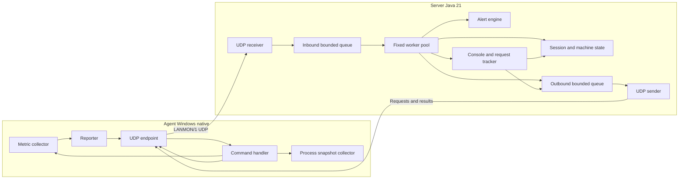
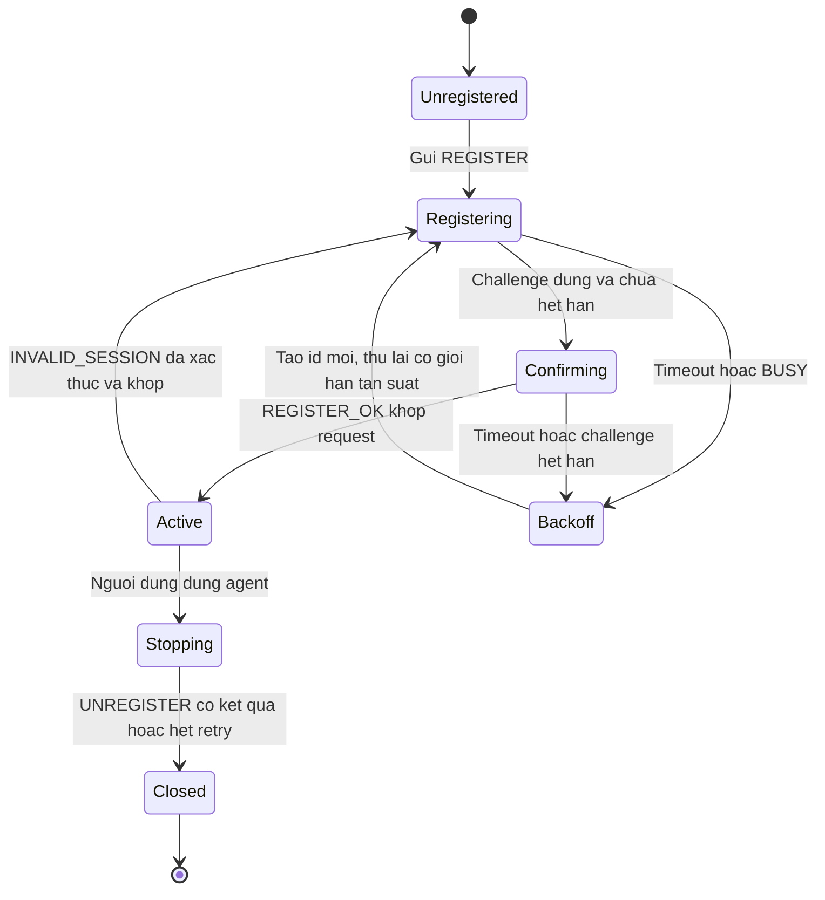
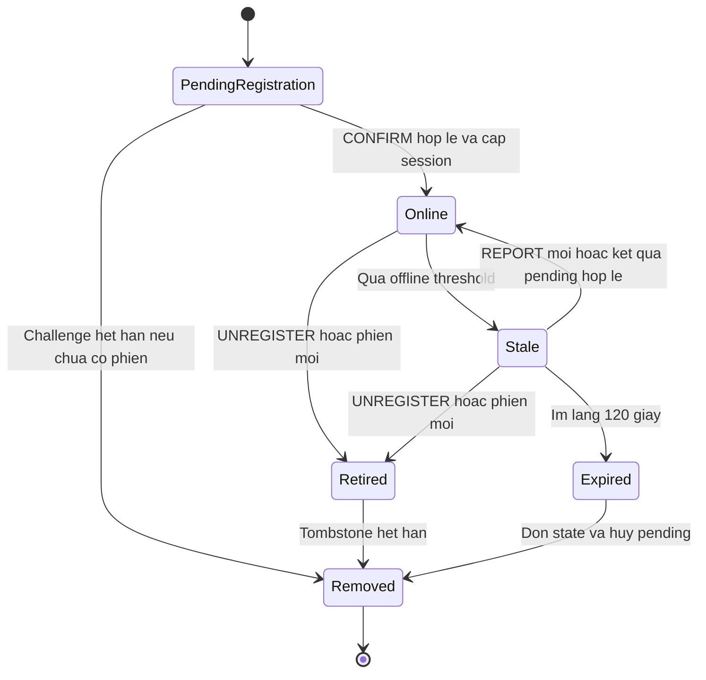

# Kiến trúc hệ thống giám sát LAN qua UDP

> Dự thảo v1 · 15/10/2026 · Phương án cho giai đoạn triển khai sau; chưa có số liệu chứng minh hiệu năng. Hợp đồng mạng: [protocol-design.md](protocol-design.md). Phạm vi và lý do bài toán: [proposal.md](proposal.md). Phân công để nhóm tự xác nhận.

## 1. Mô hình tổng thể

Một server quản lý tối đa 100 agent được cấp khóa trước. Agent và server là chương trình độc lập, chỉ giao tiếp qua UDP; không đọc file/trạng thái riêng của nhau. Maven common chỉ tái sử dụng codec/kiểu dữ liệu, không tạo kênh chia sẻ dữ liệu ngoài giao thức. Console quản trị chạy trong tiến trình server; không mở thêm dịch vụ quản trị từ xa.

## 2. Mô hình đồng thời và lựa chọn

**Đề xuất Producer–Consumer với worker cố định.** Receiver chỉ nhận, kiểm chiều dài và copy đúng byte gói vào hàng đợi 1.024 phần tử bằng offer không chờ. Bốn worker lấy gói, kiểm JSON/HMAC, kiểm phiên, cập nhật và lập phản hồi. Đầy queue thì bỏ gói mới, tăng queueDropped. Không dùng executor có hàng đợi vô hạn hoặc tạo một thread cho mỗi datagram.

| Phương án | Điểm mạnh | Đánh đổi |
|---|---|---|
| Xử lý mọi thứ trong receiver | Ít mã và ít khóa | Parse/chữ ký/xử lý chậm làm chậm toàn bộ nhận UDP |
| Một thread dài hạn/agent | Dễ hình dung với TCP | UDP không có accept; nhiều thread chờ không cần thiết |
| Producer–Consumer, fixed workers | Giới hạn CPU/RAM, dễ đo số worker và queue | Có thể xử lý đảo thứ tự; phải kiểm seq + cập nhật nguyên tử |
| Selector/NIO đầy đủ | Điều phối nhiều socket không blocking | V1 chỉ có một UDP socket; chưa cần tăng độ phức tạp |

Đây là phương án đề xuất đã ghi rõ trade-off, nhóm review trước khi chốt. Nhiều worker không đồng nghĩa chắc chắn nhanh hơn: cập nhật cùng agent vẫn cần tuần tự hóa và có chi phí tranh chấp; phải benchmark.

### 2.1 Các thread/task dự kiến

| Nơi | Luồng/task | Trách nhiệm |
|---|---|---|
| Server | 1 receiver | receive, kiểm chiều dài, copy packet; không parse/hashing/console |
| Server | WORKER_THREADS=4 | Consumer queue; xác thực, dispatch, cập nhật ngắn theo agent |
| Server | 1 sender | Lấy outbound queue và gửi UDP bằng cùng socket/cổng nguồn |
| Server | scheduler | Watchdog mỗi 1 giây, expiry, retry/backoff; không thực hiện tác vụ chờ dài |
| Server | console reader | Đọc lệnh; đọc snapshot và tạo pending; không chặn receiver/worker để đợi kết quả |
| Agent | receiver và sender | Nhận, đưa vào inbound queue; gửi qua outbound queue có giới hạn |
| Agent | bounded worker pool | Xác thực, giữ chỗ request, đọc metric/process và hoàn tất kết quả |
| Agent | scheduler/collector | Lấy mẫu, gửi REPORT theo fixed-delay, thay lịch khi SET_INTERVAL |

Dùng một UDP socket mỗi tiến trình agent trong suốt phiên; server cũng có một socket. Không tạo socket mới cho từng phản hồi vì sẽ đổi cổng nguồn và phá kiểm tra endpoint. Gửi UDP không tạo một luồng TCP riêng bị nghẽn theo từng client, nhưng socket/queue vẫn có thể quá tải. Sender tách khỏi xử lý nghiệp vụ; không giữ khóa khi gửi. Khi shutdown, đóng socket để giải phóng receive/send đang chờ. Mọi tác vụ đọc OS đều có giới hạn hàng đợi; không dùng common pool vô hạn.

## 3. Thành phần và trách nhiệm

Tên lớp/module dưới đây là dự kiến, chưa phải file đã có.

| Thành phần | Trách nhiệm |
|---|---|
| ProtocolCodec | Phong bì JSON/base64, UTF-8 nghiêm ngặt, trần 1.200 byte, schema/type/bounds, từ chối khóa trùng |
| MessageAuthenticator | HMAC-SHA256, chọn key theo agentId, kiểm MAC constant-time; không log khóa |
| UdpReceiver / UdpSender | I/O và bounded queue; không nhúng nghiệp vụ |
| RegistrationService | Challenge/confirm, retry bắt tay, giới hạn pending và kết quả, cấp/thu hồi phiên |
| SessionRegistry | Allowlist agent, endpoint, sessionId, bootId, lastReportSeq, contact deadline |
| ReportService | Áp REPORT mới nguyên tử, tạo machine snapshot bất biến |
| AlertEngine | Ngưỡng tài nguyên liên tiếp, hồi phục/cooldown, cảnh báo ứng dụng, ring buffer 200 sự kiện |
| RequestTracker | Một lệnh pending/agent; id/commandSeq, retry timer, đối chiếu phản hồi, timeout |
| ConsoleView | Danh sách máy, chi tiết, cảnh báo; GET_REPORT/GET_APPS/SET_INTERVAL/PING |
| AgentRegistration | bootId và bắt tay, đăng ký lại sau server restart/401 hợp lệ |
| MetricCollector | CPU/RAM, free bytes volume hệ thống, uptime agent; null khi không hỗ trợ/lỗi |
| ProcessCollector | Tên tiến trình có thể quan sát, số instance; không đường dẫn/args/nội dung |
| AgentCommandHandler | Chặn lệnh trái phép, command high-water, IN_PROGRESS và cache kết quả |
| SnapshotStore | Snapshot ứng dụng bất biến; phân trang theo kích thước wire thực, TTL và giới hạn |
| LoadGenerator / FaultInjector | Agent giả lập có seed, mất/trùng/đảo gói, đo và xuất CSV; không giả làm dữ liệu thật |

Không gán chủ sở hữu từ tài khoản GitHub. Bảng thành viên/phân công và README Contribution do nhóm tự hoàn thiện.

## 4. Shared state và an toàn đa luồng

| Dữ liệu dùng chung | Bên truy cập | Cách bảo vệ |
|---|---|---|
| Allowlist và khóa từng agent | Worker và khởi động | Cấu hình immutable sau startup; tối đa 100 agent |
| Session/challenge/tombstone theo agent | Worker, watchdog, console, retry | ConcurrentHashMap chứa AgentState; một khóa riêng ổn định/agent cho cập nhật lifecycle |
| lastReportSeq, lastContact, interval, machine snapshot | Worker, watchdog, console | Kiểm seq và thay toàn bộ snapshot trong cùng khóa AgentState; console lấy bản immutable rồi nhả khóa |
| Pending command + commandSeq server | Console, worker, scheduler | Cùng khóa AgentState khi giữ chỗ/hoàn tất; hủy timer, callback/future ngoài khóa |
| Inbound/outbound queue | Receiver/worker/sender | ArrayBlockingQueue; offer không chờ, kích thước cố định |
| Counter nhận/xử lý/drop | Các thread và console | LongAdder; số đo là snapshot gần thời điểm, không ép tổng tức thì luôn bằng nhau |
| Trạng thái agent, interval/reportSeq | Reporter, registration, handler | Session immutable qua AtomicReference; sequence AtomicLong, reset cùng lần đổi session dưới khóa |
| highestCommandSeq, IN_PROGRESS, cache kết quả tại agent | Agent workers/expiry | Một khóa command; kiểm và giữ chỗ nguyên tử, không có hai worker thực hiện cùng request |
| Snapshot ứng dụng | Collector/worker/expiry | Danh sách immutable, map có khóa ngắn và TTL/capacity; công bố xong mới cho phân trang |
| Cảnh báo và lịch sử bounded | Worker và console | Cập nhật theo khóa AgentState; ring buffer riêng chép dữ liệu trước khi hiển thị |

### 4.1 Thứ tự thao tác và tránh deadlock

1. Parse/HMAC ngoài khóa; nguồn cấu hình immutable. Gói đã xác thực vẫn phải được kiểm lại sessionId **trong khóa** trước khi áp dụng, vì worker khác có thể vừa thay phiên.
2. Khóa duy nhất một AgentState để xác minh endpoint/seq, cập nhật state, tính chuyển trạng thái và tạo mô tả sự kiện/phản hồi. Không khóa hai agent cùng lúc. Không lấy khóa global registry trong lúc giữ khóa agent; cấu hình khóa ổn định theo allowlist giúp tránh đổi lock object khi phiên đổi.
3. Nhả khóa trước khi serialize/ký phản hồi, offer outbound, ghi log/console hoặc chạy callback. Thông điệp phản hồi gắn sessionId cũ sẽ bị phía nhận bỏ nếu phiên đã đổi.
4. Lấy mẫu OS/process ngoài khóa. Khi hoàn tất command, kiểm lại session vẫn hiện hành; nếu đã bị thay thì không sửa lịch hoặc công bố kết quả cho phiên mới. SET_INTERVAL chỉ đổi lịch qua thao tác ngắn có kiểm phiên, không giữ khóa qua thao tác đọc OS.
5. Scheduler expiry không xóa entry IN_PROGRESS đang thực hiện; thao tác đó có ngân sách xử lý, bị hủy/đóng phiên nếu quá hạn để tránh giữ tài nguyên vô hạn. Không xử lý request trùng lần hai khi tác vụ cũ còn chạy.

Worker xử lý REPORT seq 12 trước 11 là hợp lệ; worker 11 phải thấy lastReportSeq=12 và bỏ. Cảnh báo được tính theo thứ tự các báo cáo được chấp nhận, không theo thứ tự socket receive hoặc timestamp máy agent.

### 4.2 Gửi chậm và quá tải

Inbound/outbound đều drop-newest khi đầy. REPORT bị bỏ sẽ được bản mới thay thế; request/reply bị bỏ sử dụng retry §6 giao thức. Kết quả command phải được cache trước khi offer outbound để retry vẫn nhận kết quả mà không lặp tác động. Không dùng queue vô hạn, CallerRunsPolicy trên receiver hoặc chờ CompletableFuture trong worker để đợi mạng.

Tổng số cache/snapshot/pending bị chặn bởi giới hạn theo phiên và số agent. Session hết hạn phải hủy pending, snapshot và kết quả phiên liên quan theo chính sách tombstone. Cùng agent nhiều tiến trình dùng chung khóa/cấu hình sẽ tranh phiên; bản đầu yêu cầu một agent đang hoạt động cho mỗi agentId, không hỗ trợ nhiều thiết bị dùng chung id.

## 5. Vòng đời

### 5.1 Agent

Agent lấy bootId mới khi tiến trình khởi động. Khi chỉ mất phản hồi REPORT thì tiếp tục gửi, không tự tạo phiên mới mỗi chu kỳ. Đăng ký lại hủy pending/snapshot cũ và không nhận kết quả phiên cũ. Trong bắt tay challenge, server giữ phiên cũ cho tới CONFIRM hợp lệ; REGISTER bị replay không tự làm máy đăng ký lại.

### 5.2 Trạng thái tại server

Online dùng lastContact, đồng thời giao diện luôn hiển thị tuổi dữ liệu tài nguyên qua lastReportAt. PONG mới có thể xác nhận agent còn phản hồi dù metric đã cũ; không tô metric cũ thành dữ liệu vừa lấy. Không có EOF cho UDP; đóng agent đột ngột chỉ phát hiện qua timeout.

### 5.3 Shutdown server

Đánh dấu stopping, ngừng nhận lệnh console và tạo retry; hủy timer, đóng socket để unblock I/O. Ngừng nhận queue mới, hủy pending bằng thông báo local “server đang dừng”; tác vụ chưa chạy không được thực hiện sau shutdown. Shutdown executor, chờ có deadline tối đa 5 giây, sau đó interrupt/cancel, join receiver/sender, dọn state trong RAM. Không giữ khóa agent khi await termination. Bản đầu không lưu phiên hoặc cache qua restart; agent tự bắt tay lại theo giao thức. Cần kiểm chứng không còn thread giữ JVM chạy sau khi dừng.

## 6. Triển khai và cấu hình

| Chương trình | Cách chạy dự kiến | Địa chỉ/cổng |
|---|---|---|
| Server | Docker Java 21, docker compose up --build | SERVER_HOST=0.0.0.0, SERVER_PORT=5000, publish 5000:5000/udp |
| Agent demo Docker | Service client của starter, artifact agent | CLIENT_TARGET_HOST=server, CLIENT_TARGET_PORT=5000 |
| Agent Windows thật | Java 21 native | CLIENT_TARGET_HOST là IP LAN server hoặc localhost; cổng cấu hình |
| Load generator | Native hoặc container, đánh dấu simulated | Cùng giao thức và khóa thử riêng từng agent |

Server/agent lấy network settings từ môi trường; không commit địa chỉ máy thật. Cấu hình dự kiến bổ sung ở công việc số 2:

| Biến | Mặc định / ý nghĩa |
|---|---|
| SERVER_HOST, SERVER_PORT | 0.0.0.0 / 5000 |
| CLIENT_TARGET_HOST, CLIENT_TARGET_PORT | server / 5000 trong Compose; native tự cấu hình |
| AGENT_ID, AGENT_HOSTNAME | Bắt buộc nhận diện ổn định; không tự dùng username cá nhân |
| AGENT_KEY_FILE | File khóa agent 32 byte ngoài Git, mount read-only khi dùng Docker |
| SERVER_KEYS_FILE | Allowlist agentId → key, ngoài Git; không copy vào image |
| REPORT_INTERVAL_MS | Server cấp 2000 khi đăng ký; SET_INTERVAL runtime trong 1000–10000 |
| WORKER_THREADS | 4; validate >0 và ghi khi benchmark |
| INBOUND_QUEUE_CAPACITY, OUTBOUND_QUEUE_CAPACITY | 1024, 1024; cùng giới hạn ở protocol |
| CPU_ALERT_PCT, RAM_ALERT_PCT | Đề xuất 90, 90; hợp lệ 0..100 |
| DISK_FREE_ALERT_BYTES | Đề xuất 10 GiB = 10737418240 byte; hợp lệ không âm |
| ALERT_CONSECUTIVE_REPORTS, ALERT_COOLDOWN_MS | Đề xuất 3 báo cáo hợp lệ và 30000 ms |
| WATCHED_APPS_FILE | Danh sách tên ứng dụng cấu hình ngoài dữ liệu tiến trình |
| LOG_LEVEL | INFO; không log khóa/MAC hoặc nguyên danh sách ứng dụng mặc định |

Chu kỳ thay đổi có hiệu lực trong RAM, không tự ghi đè biến môi trường; agent/server restart quay về mặc định REGISTER_OK. Các TTL, trần gói và giới hạn phiên/ảnh chụp theo LANMON/1 phải đồng nhất. .env.example/Compose hiện còn là starter, chưa tuyên bố các biến hoặc image trên đã triển khai.

Cấu trúc Maven dự kiến: common (codec/auth/schema), server, agent, loadtest. Bước dựng module là công việc số 2, chưa làm trong lần viết tài liệu này. Thư mục client/shared hiện có của starter sẽ được đối chiếu/sắp xếp khi dựng module; service Compose client vẫn có thể trỏ artifact agent để theo hướng dẫn môn học.

Đo CPU/RAM trong container có thể khác tài nguyên host; demo Windows dùng agent native và ghi rõ nguồn dữ liệu. Khóa HMAC không mã hóa telemetry; v1 chỉ dùng LAN được quản lý và sự đồng ý rõ ràng. Không thu website/nội dung/keystroke và không nhận lệnh hệ điều hành tùy ý.

## 7. Cảnh báo và hiển thị

REPORT chấp nhận cập nhật metric nguyên tử. Cảnh báo CPU/RAM chỉ khi vượt ngưỡng đủ 3 mẫu hợp lệ liên tiếp; một mẫu dưới ngưỡng hoặc null reset chuỗi vượt ngưỡng. Cảnh báo được gộp theo (agent, loại), cooldown 30 giây; thông báo hồi phục khi có mẫu hợp lệ dưới ngưỡng. Disk free thấp cảnh báo từ mẫu hợp lệ; null chỉ hiển thị không hỗ trợ/lỗi đọc. Offline/online tạo sự kiện khi chuyển trạng thái, không spam mỗi lần watchdog.

Ứng dụng được lấy qua GET_APPS theo yêu cầu; so hai snapshot hoàn tất để ghi nhận mở/đóng quan sát được. Chỉ suy ra đóng nếu snapshot mới không bị truncated; snapshot lỗi/hết hạn/tải dở không tạo sự kiện đóng hàng loạt. Cảnh báo ứng dụng thuộc danh sách cấu hình khi quan sát thấy; không nhận định người dùng đã truy cập nội dung gì. Nhìn ứng dụng tự động liên tục chỉ thêm sau nếu nhóm chốt chu kỳ, giới hạn request và ngân sách tải.

## 8. Kiểm thử và đo tải dự kiến

| Nhóm | Cách kiểm chứng cần triển khai |
|---|---|
| Codec/auth | UTF-8, duplicate keys, sai kiểu, HMAC sai, payload vượt 1200, khóa unknown, direction sai |
| Phiên | Challenge cũ/expired/retry, hai REGISTER cạnh tranh, server restart, đổi endpoint, gói phiên cũ |
| REPORT | Mất/trùng/đảo seq, hai worker cùng cập nhật, seq vượt giới hạn, metric null và đơn vị |
| Lệnh | Mất request/result, retry cùng id, id khác body, IN_PROGRESS, seq cũ sau cache expiry, TTL/capacity, timeout chưa rõ kết quả |
| Snapshot | UTF-8 tên dài, đầy đủ trang trong 1200 byte, thay tiến trình giữa trang, snapshot rỗng/truncated/hết hạn |
| Liveness/shutdown | Agent kill, silent, đổi interval, UNREGISTER mất phản hồi, socket và worker đóng đúng deadline |
| Tải | 10/50/100 agent; 1 và 4 worker; queue/rate giữ tương đương; warm-up 10s, đo 60s, tối thiểu 3 lần mỗi cấu hình chọn |
| LAN/Docker | Hai máy thật, nhiều agent, clean build Docker, firewall UDP và Wireshark |

Counter dự kiến: received, oversize, inboundDropped, malformed, authRejected, invalidSession, duplicateReport, staleReport, processed, outboundDropped, retryCount, requestTimeout. Độ trễ xử lý đo trong một tiến trình từ enqueue đến xử lý xong; RTT lệnh đo ở server từ lần gửi đầu đến kết quả và ghi số retry. Không gọi thời gian report agent→server là độ trễ một chiều chính xác khi đồng hồ chưa đồng bộ.

FaultInjector ở mức ứng dụng dùng seed tái lập, chỉ giữ tối đa số gói trì hoãn cấu hình; không dùng timer/queue vô hạn để tạo lỗi thử nghiệm. Phải ghi rõ đây là mô phỏng ứng dụng, không giả nhận đã thay toàn bộ điều kiện mạng. Counter khoảng trống seq chỉ là ước lượng sau cửa sổ quan sát, không đồng nhất tức thì với mất trên mạng.

Ghi kết quả chạy thật vào docs/testing-guide.md sau khi triển khai. Tài liệu này không thay thế test và không khẳng định các mức tải đã đạt. M1 chỉ chốt đề xuất; M2 cần skeleton Docker chạy; M3 cần tính năng và minh chứng.

## 9. Quyết định và phần nhóm cần review

Phạm vi Java 21 + Windows + console + khóa riêng từng agent đã được xác nhận trong trao đổi. Phần thiết kế cụ thể đang đề xuất để nhóm review: phong bì base64/HMAC, challenge đăng ký, hai dãy seq, một pending/agent, snapshot 60 giây/256 mục, giới hạn queue/cache và ngưỡng cảnh báo. Chọn các phương án này nhằm giữ giao thức hữu hạn và có thể kiểm thử, không làm một bản TCP hay điều khiển máy từ xa thu nhỏ.

Không thêm GUI, DB hoặc tính năng ngoài phạm vi để tăng số lệnh. Khi nhóm thay hợp đồng mạng, cập nhật protocol-design.md cùng lúc; khi thay mô hình khóa, cập nhật bảng shared state và bài test cạnh tranh. Bảng phân công/đóng góp và phần tự kiểm chứng AI do nhóm tự ghi nhận.
