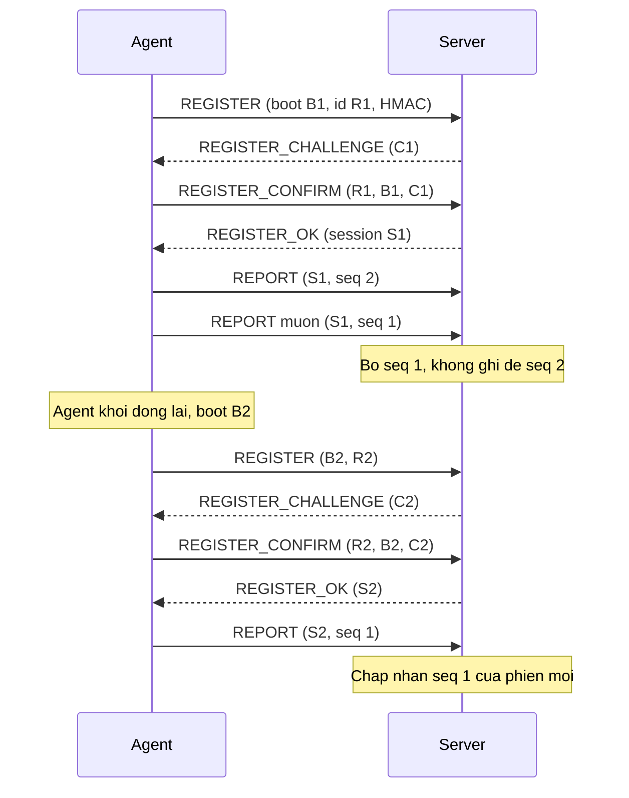
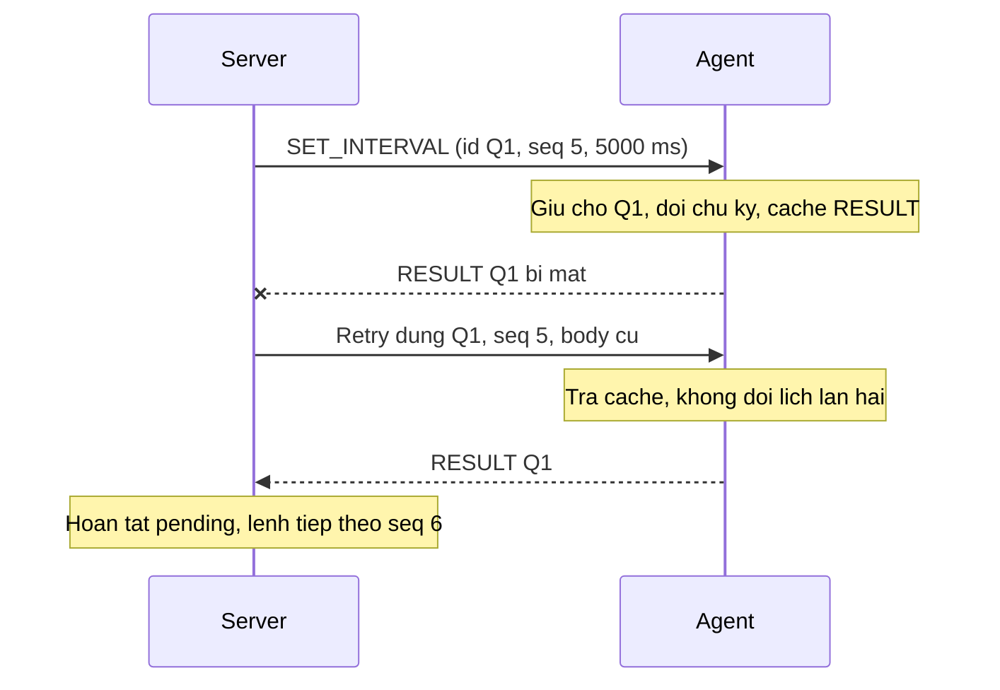
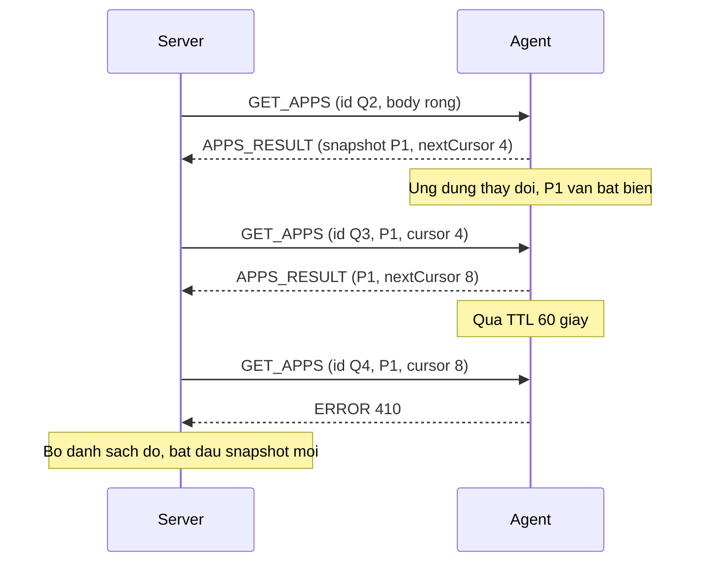

# LANMON/1 — Đặc tả giao thức giám sát UDP

> Dự thảo v1 · 15/10/2026 · Thiết kế để triển khai, chưa phải mô tả tính năng đã chạy. Phạm vi: Java 21, agent Windows, console, một server; không GUI/DB. Nhóm review các hằng số và đánh đổi trước khi lập trình. Không thay đổi đề bài INSTRUCTION.md.

## 1. Tổng quan

| Thuộc tính | Quy định đề xuất |
|---|---|
| Transport | UDP unicast trong LAN; socket agent dùng cùng cổng nguồn suốt phiên |
| Cổng server | Mặc định 5000/UDP, lấy từ SERVER_PORT; bind SERVER_HOST=0.0.0.0 trong container |
| Đích agent | CLIENT_TARGET_HOST/CLIENT_TARGET_PORT; Docker dùng server, native dùng địa chỉ máy server |
| Encoding/framing | Một datagram = một phong bì JSON UTF-8; không length-prefix, newline hoặc ghép luồng TCP |
| Phiên | Stateful; bootId nhận diện một lần chạy agent; sessionId mới do server sinh sau bắt tay |
| Dữ liệu | REPORT thay thế trạng thái cũ, không ACK; lệnh yêu cầu/kết quả có retry và chống trùng |
| An toàn | HMAC-SHA256 với khóa 32 byte riêng từng agent, cấp ngoài giao thức; không mã hóa nội dung |

UDP không tạo kết nối hay báo EOF như TCP. Online/mất cập nhật là trạng thái ứng dụng, không phải kết luận hệ điều hành còn sống. Tài liệu triển khai/thử nghiệm phải phân biệt mất tại mạng, bị loại vì lỗi và bị bỏ vì hàng đợi đầy.

## 2. Wire format và kiểm tra kích thước

Tối đa **1.200 byte cho toàn bộ UDP payload**, bao gồm phong bì và MAC. Đây là giới hạn ứng dụng để hạn chế phân mảnh trong LAN thông thường, không bảo đảm phù hợp mọi MTU; bản đầu không tự dò MTU hay ghép mảnh ở tầng ứng dụng. Dùng bộ đệm nhận 65.507 byte và lấy đúng offset/length; gói dài hơn 1.200 byte bị bỏ trước parse. Đặt lại độ dài buffer trước mỗi lần receive nếu tái sử dụng DatagramPacket.

Phong bì ngoài chỉ có ba trường, không chấp nhận khóa JSON trùng:

```json
{"agentId":"PC-02","payload":"<base64url-khong-padding>","mac":"<64-ky-tu-hex-thuong>"}
```

Đây là sơ đồ định dạng, không phải gói có chữ ký hợp lệ. `payload` là base64url không padding của **đúng byte UTF-8 JSON nội dung**. Cách tính:

```text
mac = lowercaseHex(HMAC-SHA256(agentKey,
      ASCII("LANMON/1\n" + agentId + "\n" + payload)))
```

`\n` trong công thức là byte LF 0x0A. `agentId` chỉ gồm [a-zA-Z0-9_-], dài 1–32; khóa agent được chọn từ allowlist cấu hình bằng agentId ngoài. So MAC theo constant-time. Không ký JSON sau khi deserialize/serialize lại: thứ tự khóa, khoảng trắng hoặc biểu diễn số có thể khác. Sau xác minh MAC mới parse nội dung; agentId trong/ngoài phải trùng. MAC sai, agent lạ, UTF-8 lỗi, gói quá lớn hoặc không đọc được phong bì: bỏ im lặng và tăng counter; không phản hồi đến địa chỉ chưa xác thực.

Nội dung logic ví dụ (trước base64 và ký):

```json
{
  "v":1,
  "type":"REPORT",
  "from":"agent",
  "agentId":"PC-02",
  "sessionId":"00000000-0000-4000-8000-000000000002",
  "id":"00000000-0000-4000-8000-000000000125",
  "seq":125,
  "body":{"cpuPct":35.0,"ramPct":62.0,"diskFreeBytes":80000000000,"uptimeSec":7200,"intervalMs":2000}
}
```

UUID trong ví dụ chỉ minh họa; không dùng giá trị cố định để chạy thật.

## 3. Envelope logic và định danh

| Trường | Kiểu, ràng buộc |
|---|---|
| v | Integer, bắt buộc bằng 1 |
| type | String thuộc bảng §4; đúng chiều gửi |
| from | agent hoặc server; nằm trong payload đã ký, không chấp nhận phản xạ thông điệp ngược chiều |
| agentId | String 1–32, như §2 |
| sessionId | UUID; chuỗi rỗng chỉ cho REGISTER/REGISTER_CHALLENGE/REGISTER_CONFIRM và lỗi trước cấp phiên |
| id | UUID của báo cáo hoặc yêu cầu; phản hồi copy id yêu cầu |
| seq | Integer 0..9007199254740991; quy tắc theo nhóm dưới đây, không chấp nhận chuỗi/số thực |
| body | Object bắt buộc; không có dữ liệu thì {} |

Không chấp nhận null ở các trường trên, khóa trùng, phiên bản khác 1, số không hữu hạn, trường lạ hoặc sai kiểu. Các bộ phận chỉ chia sẻ đặc tả, không truy cập bộ nhớ của nhau. Không yêu cầu đồng bộ đồng hồ giữa máy; deadline/liveness dùng đồng hồ monotonic của nơi nhận.

Có hai dãy số **độc lập** trong mỗi phiên:

- `REPORT.seq`: agent tăng từ 1; server chỉ áp dụng seq lớn hơn lastReportSeq. Báo cáo cũ/trùng không thay dữ liệu hoặc kéo dài thời gian sống.
- `command.seq`: server tăng từ 1 cho GET_REPORT/GET_APPS/SET_INTERVAL/PING; mọi phản hồi copy seq. Một agent chỉ có **một lệnh server đang chờ** tại một thời điểm. Lệnh kế tiếp có thể bỏ số; không được giảm hay tái sử dụng số cho id khác.
- Bắt tay và UNREGISTER dùng seq=0. id của lần gửi lại giữ nguyên; REPORT mới luôn có id mới. Không suy ra thứ tự từ UUID, đồng hồ hoặc reportSeq của GET_REPORT.

Server/agent sinh UUID và challenge bằng nguồn ngẫu nhiên mật mã. bootId mới cho mỗi lần chạy agent, giữ ổn định trong lúc đăng ký lại sau server restart. sessionId do server sinh, là định danh chứ không thay thế HMAC. Không gửi khóa qua UDP hay ghi vào log/Git.

## 4. Bảng thông điệp

A = agent; S = server. Mọi phản hồi đều đã ký, đúng id/seq/agentId; đúng sessionId trừ REGISTER_OK cấp phiên mới. Trường body dưới đây là đầy đủ, trừ mục ghi tùy chọn.

| Type | Chiều | Body | Phản hồi/kết quả |
|---|---|---|---|
| REGISTER | A → S | bootId: UUID, hostname: string 1–64, platform: "windows" hoặc "simulated" | REGISTER_CHALLENGE hoặc ERROR |
| REGISTER_CHALLENGE | S → A | bootId, challenge: 64 hex, expiresInMs:10000 | Agent kiểm chữ ký, gửi REGISTER_CONFIRM cùng id |
| REGISTER_CONFIRM | A → S | bootId, challenge | REGISTER_OK hoặc ERROR |
| REGISTER_OK | S → A | bootId, intervalMs:2000, offlineAfterMs:10000 | sessionId mới ở envelope; kết thúc bắt tay |
| REPORT | A → S | cpuPct, ramPct, diskFreeBytes, uptimeSec, intervalMs | Không ACK; lỗi phiên có thể trả ERROR |
| GET_REPORT | S → A | {} | REPORT_RESULT hoặc ERROR |
| REPORT_RESULT | A → S | Cùng schema REPORT; mẫu thu tại lúc xử lý yêu cầu | Chỉ kết thúc request, không tăng lastReportSeq |
| GET_APPS | S → A | Trang đầu {}; trang sau {snapshotId:UUID,cursor:integer} | APPS_RESULT hoặc ERROR |
| APPS_RESULT | A → S | snapshotId, items:[{name,instances}], nextCursor:integer hoặc null, truncated:boolean | Trang cuối nextCursor=null |
| SET_INTERVAL | S → A | intervalMs: integer 1000..10000 | RESULT {command:"SET_INTERVAL",intervalMs} hoặc ERROR |
| PING | S → A | {} | PONG {} hoặc ERROR |
| UNREGISTER | A → S | reason: "shutdown" | RESULT {command:"UNREGISTER"} hoặc ERROR |
| RESULT | Ngược yêu cầu | Như hai dòng trên | Thành công terminal |
| ERROR | Ngược yêu cầu | code:integer, message:string tối đa 96 byte UTF-8 | Thất bại terminal, ngoại lệ §5 |

Hostname/name không chứa ký tự điều khiển; tên ứng dụng tối đa 80 byte UTF-8 sau làm sạch/cắt tại ranh giới ký tự; instances là số nguyên 1..65535. Không gửi đường dẫn đầy đủ, tham số tiến trình, URL, nội dung ứng dụng hoặc thao tác bàn phím.

Metrics đo toàn máy: cpuPct là tải CPU hệ thống trên khoảng lấy mẫu gần nhất; ramPct là phần trăm RAM vật lý đang dùng. Mẫu đầu chưa đủ dữ liệu là null. cpuPct/ramPct là số hữu hạn 0..100 hoặc null nếu không lấy được; diskFreeBytes và uptimeSec là số nguyên 0..9007199254740991 hoặc null. diskFreeBytes đo volume hệ thống của agent, không cộng tùy ý nhiều ổ; uptimeSec là thời gian agent chạy, không phải uptime Windows. intervalMs luôn là chu kỳ hiện hành hợp lệ. Metric null được hiển thị “không hỗ trợ/lỗi đọc”, không đổi thành 0 và không kích hoạt cảnh báo tài nguyên. Danh sách ứng dụng dựa trên tiến trình có thể quan sát; không chứng minh người dùng đang thao tác.

## 5. Bắt tay, phiên và liveness

1. Agent gửi REGISTER đã ký, sessionId="", seq=0, id và bootId ổn định cho một lần bắt tay.
2. Server kiểm allowlist/HMAC, tạo challenge ngẫu nhiên 32 byte. Tối đa một challenge đang chờ mỗi agent, TTL 10 giây; chưa thay phiên đang hoạt động. REGISTER lặp đúng id/bootId/endpoint trả lại challenge cũ; id khác khi còn challenge trả 409.
3. Agent chỉ phản hồi challenge đúng lần đăng ký mình đang chờ và gửi REGISTER_CONFIRM cùng id/bootId/endpoint. Server so challenge, TTL và HMAC rồi mới cấp phiên; hủy phiên cũ, reset reportSeq/commandSeq và hủy request cũ.
4. Server giữ kết quả bắt tay 60 giây. CONFIRM trùng còn cache nhận cùng REGISTER_OK, không reset phiên lần nữa. Kết quả thuộc phiên đã bị thay không được làm agent/server quay lại phiên cũ; trả 409. Challenge đã hết hạn không được tái kích hoạt, kể cả cache kết quả bị dọn.
5. Trong phiên, xác minh cả HMAC, sessionId và IP:cổng nguồn đã đăng ký. Endpoint đổi thì agent phải bắt tay lại; không tự di chuyển phiên chỉ vì thấy id đúng. Agent chỉ nhận lệnh từ endpoint server cấu hình.

REGISTER dùng retry §6 cho từng bước; nếu challenge hết hạn, tạo id đăng ký mới, không phát lại CONFIRM cũ. Cả hai phía chỉ chuyển trạng thái sau khi kiểm chứng thông điệp khớp trạng thái đang chờ. Gói cũ có thể khơi một challenge nhưng không thay phiên nếu không có xác nhận challenge mới. Server có giới hạn/rate limit cho bắt tay (§9); đây không phải giải pháp chống mọi tấn công DoS.

`lastContact` chỉ cập nhật khi chấp nhận thông điệp mới trong phiên: REPORT seq mới hoặc phản hồi khớp request đang chờ. `lastReportAt` chỉ theo REPORT mới. Báo cáo cũ/lỗi/retry đã xử lý không làm máy online giả. Ngưỡng mất cập nhật = max(10.000 ms, 3 × intervalMs); watchdog kiểm mỗi 1 giây. Trong SET_INTERVAL đang chờ, tạm dùng max(chu kỳ cũ, chu kỳ yêu cầu) để tránh báo offline nhầm. REPORT hợp lệ công bố intervalMs hiện tại; RESULT hợp lệ cũng xác nhận giá trị mới.

Mất cập nhật không hủy phiên ngay; báo cáo mới hợp lệ làm online trở lại. Sau 120 giây không có liên lạc mới, thu hồi phiên và cache liên quan; báo cáo dùng phiên hết hạn nhận 401. Server restart làm mất toàn bộ phiên. Agent nhận 401 đã ký, đúng endpoint và khớp phiên/id của báo cáo mới nhất đang theo dõi hoặc request hiện hành thì đăng ký lại; không phản ứng với 401 không khớp. Khi không nhận REGISTER_OK, backoff 1,2,4,8 rồi tối đa 10 giây, thêm jitter 0–250 ms.

UNREGISTER chủ động kết thúc phiên, làm máy offline; server giữ tombstone/kết quả 60 giây để trả cùng RESULT cho retry, không hồi sinh phiên. Agent chỉ nhận RESULT khớp request dừng và thoát sau tối đa ngân sách retry. Dừng đột ngột không có UNREGISTER: server dùng timeout.

## 6. Retry, thứ tự và chống thực hiện lặp

Áp dụng REGISTER, REGISTER_CONFIRM, GET_REPORT, GET_APPS, SET_INTERVAL, PING, UNREGISTER; REPORT không retry/ACK. Tối đa **3 lần gửi tổng cộng**, vào t≈0,1,3 giây, kết thúc chờ ở t≈7 giây; mỗi khoảng chờ thêm jitter 0–250 ms. Các lần gửi lại cùng id, seq và payload, không lấy mẫu lại kết quả. Không retry vô hạn hoặc tăng tốc khi nghẽn.

Phía agent, xử lý lệnh server theo thứ tự:

1. Kiểm endpoint/HMAC/phiên và schema. Khóa trạng thái lệnh ngắn để tra cache theo (sessionId,id).
2. Có cache và cùng type/seq/body: trả kết quả cũ; cùng id khác nội dung: 409, không thực hiện.
3. Không có cache, seq ≤ highestCommandSeq: 409 STALE_COMMAND, không thực hiện kể cả cache đã hết TTL. Điều này chặn lệnh cũ quay lại sau 60 giây.
4. Với seq mới, giữ chỗ IN_PROGRESS và tăng highestCommandSeq nguyên tử. Worker khác gặp retry đang chạy sẽ không khởi động lần hai; chưa có kết quả thì bỏ lần retry đó để người gửi chờ/thử tiếp.
5. Thực hiện, tạo/ký và cache kết quả thành công hoặc lỗi 60 giây trước khi gửi. Không giữ khóa khi đọc tài nguyên, liệt kê tiến trình hoặc gửi UDP. Lỗi nội bộ cũng hoàn tất request bằng ERROR 500.

Cache tối đa 128 lệnh/phiên. Nếu không thể giữ chỗ vì đầy sau khi dọn entry hết hạn: cập nhật high-water seq và trả 429, không thực hiện. Trường hợp này không cache được kết quả; retry có thể nhận 409 thay 429 nhưng vẫn không thực hiện. Không đẩy entry chưa hết hạn ra ngoài để lấy chỗ thực hiện lệnh mới.

Server chỉ có một request chưa kết thúc/agent; REGISTER/UNREGISTER là vòng đời riêng, không lẫn vào commandSeq. Phản hồi chỉ hoàn tất pending khi đúng type phản hồi mong đợi, id, seq, session, endpoint và HMAC; bỏ phản hồi muộn/trùng. Seq tăng khi tạo request mới, không khi retry. GET_REPORT retry trả mẫu cũ đã cache; muốn mẫu mới phải tạo request mới.

Timeout nghĩa là **không xác nhận được kết quả**, không tự khẳng định chưa thực hiện. SET_INTERVAL là đặt giá trị tuyệt đối; người quản lý có thể kiểm tra intervalMs trong REPORT tiếp theo. Chống trùng chỉ trong phiên/tuổi thọ tiến trình, không cam kết exactly-once qua crash. Không thêm lệnh có tác động hệ điều hành khó đảo ngược vào v1.

## 7. Snapshot danh sách ứng dụng

Trang đầu GET_APPS {} tạo snapshot bất biến: nhóm theo tên tiến trình đã làm sạch, đếm instances, sắp xếp tên tăng dần. Tối đa 256 tên khác nhau; nếu nhiều hơn lấy 256 tên đầu và truncated=true, không ngầm khẳng định danh sách đầy đủ. Cùng snapshot mọi trang dùng chung truncated. PID, đường dẫn, tham số lệnh không đưa vào giao thức.

snapshotId ngẫu nhiên; TTL 60 giây tính từ lúc tạo, không gia hạn khi đọc. Tối đa 2 snapshot sống mỗi agent/phiên; request tạo snapshot cũng chịu giới hạn command cache. Snapshot sống không bị đẩy ra để tạo cái mới. Hết chỗ trả 429.

Trang tiếp theo gửi snapshotId và cursor nguyên 0..số mục-1; cursor là chỉ số mục bắt đầu. Agent thêm dần items đến khi **toàn bộ phong bì đã ký** vừa 1.200 byte; nextCursor là chỉ số mục chưa gửi, trang cuối null. Mỗi trang không rỗng phải tiến cursor; snapshot rỗng trả items=[],nextCursor=null. Không áp một số mục cố định rồi hy vọng đủ byte. Nếu metadata + một mục không vừa sau giới hạn tên, trả 413 thay vì vòng lặp trang rỗng.

Retry đúng id ưu tiên trả cache cũ, kể cả snapshot vừa hết hạn; request trang mới với snapshot hết hạn trả 410. Snapshot khác phiên/không tồn tại cũng trả 410. Cursor sai kiểu/phạm vi trả 400. Client không nối trang từ snapshot khác; gặp 410 thì bỏ danh sách tải dở và bắt đầu snapshot mới. Phát hiện ứng dụng mở/đóng chỉ giữa các snapshot hoàn tất, không so từng trang; nếu truncated=true phải ghi nhận giới hạn, không suy ra ứng dụng vắng là chắc chắn đã đóng.

## 8. Mã lỗi và xử lý dữ liệu bất thường

| Code | Ý nghĩa |
|---|---|
| 400 BAD_REQUEST | Đã xác thực nhưng thiếu/sai trường, type sai chiều, cursor/metric không hợp lệ |
| 401 INVALID_SESSION | Phiên không tồn tại/hết hạn; không dùng lỗi này để phản hồi HMAC sai |
| 403 FORBIDDEN | Phiên đúng nhưng endpoint không khớp hoặc lệnh bị cấu hình cấm |
| 404 NOT_FOUND | Agent được chọn trên console không tồn tại: lỗi local, không phát gói tới địa chỉ tùy ý |
| 409 CONFLICT | Challenge đang chờ khác id, challenge không khớp, id tái dùng, lệnh cũ |
| 410 SNAPSHOT_EXPIRED | Snapshot không tồn tại/hết hạn/khác phiên |
| 413 TOO_LARGE | Không tạo được phản hồi trong giới hạn sau phân trang; gói nhận quá lớn bị drop, không trả lỗi |
| 429 BUSY | Hết phiên/challenge/snapshot/cache hoặc giới hạn xử lý hợp lệ |
| 500 INTERNAL_ERROR | Lỗi xử lý đã được chặn tại handler; không lộ stack trace/khóa |

ERROR không được trả lời bằng ERROR, không có vòng lặp phản hồi. Chỉ gửi lỗi cho yêu cầu hoặc REPORT đã xác thực có id/seq đọc được; lỗi cấu trúc không có đủ định danh để ghép thì bỏ. REPORT cũ/trùng bị bỏ im lặng. Phản hồi không khớp pending bị bỏ, không tạo request mới. SessionId lỗi phản hồi giữ giá trị nhận vào để agent ghép; lỗi bắt tay giữ sessionId rỗng. Lỗi quyền endpoint được gửi đến endpoint đã đăng ký nếu có, không đổi địa chỉ phiên. Queue đầy thì drop và đếm, không bắt receiver parse/ký để phản hồi 429.

## 9. Giới hạn mặc định và cấu hình

| Giới hạn | Giá trị đề xuất |
|---|---|
| UDP payload | 1.200 byte |
| REPORT interval | 2.000 ms, SET_INTERVAL trong 1.000–10.000 ms |
| Offline | max(10 giây, 3 × chu kỳ); kiểm mỗi 1 giây |
| Session retention | 120 giây im lặng; tối đa 100 phiên |
| Pending registration | 1/agent, 100 toàn server; TTL 10 giây |
| Kết quả bắt tay/tombstone | 60 giây; tối đa 2 record/agent; đầy thì 429, không evict record còn hạn |
| Tần suất REGISTER mới | Tối đa 1/giây/agent; retry cùng id dùng challenge/cache hiện tại |
| Command pending | 1/agent tại server, toàn cục không quá số phiên |
| Kết quả command | TTL 60 giây, 128 entry/agent |
| Snapshot | TTL 60 giây; 2 snapshot/agent; 256 tên/snapshot |
| Queue | Inbound 1.024, outbound 1.024; drop-newest khi đầy |
| Worker | 4; điều chỉnh khi đo tải, không giả định số này tối ưu |
| Cảnh báo lưu RAM | Tối đa 200 sự kiện, bỏ sự kiện cũ nhất |

Các giá trị cấu hình phải được validate khi khởi động. Tham số ảnh hưởng hai phía như trần gói, retry, TTL và số phiên thuộc v1 phải nhất quán; đổi hợp đồng cần cập nhật tài liệu/version, không tự sửa một phía. Agent chưa biết cấu hình interval của server dùng REGISTER_OK; expiry của cache/snapshot là quy định chung ở đây, không dựa vào đồng hồ Windows đồng bộ.

## 10. Các luồng chính

### 10.1 Đăng ký, báo cáo và agent restart



### 10.2 Đã đổi cấu hình nhưng mất kết quả



### 10.3 Phân trang và snapshot hết hạn



## 11. Lý do thiết kế và tiêu chí kiểm chứng

| Lựa chọn | Phương án khác / đánh đổi | Kiểm chứng cần làm |
|---|---|---|
| UDP cho cả hệ thống, retry chọn lọc | TCP giảm việc tự làm tin cậy; UDP thể hiện tách báo cáo/lệnh | Loss, duplicate, reorder có seed; lệnh không bị thực hiện lặp |
| HMAC trên chuỗi base64 nguyên vẹn | Ký JSON canonical phức tạp; base64 tăng kích thước | Byte bị sửa/MAC sai bị bỏ; from ngược chiều bị từ chối |
| Challenge xác nhận đăng ký | REGISTER một gói dễ replay tạo phiên lại | Replay REGISTER/CONFIRM cũ không thay phiên hợp lệ |
| Phiên + hai dãy seq | Một seq chung sẽ bỏ nhầm lệnh khi REPORT đến trước | Restart, command muộn, cache hết hạn, REPORT ngược thứ tự |
| Snapshot có phân trang | Chia mảnh thông điệp lớn cần ghép và retry từng mảnh | Tên UTF-8 dài, đủ trang, gói ≤1.200 byte, 410 và truncated |
| Bounded queue/cache | Không giới hạn đơn giản nhưng có thể cạn RAM | Stress/drop counter, thời gian dừng, xử lý lại sau quá tải |

Nhóm cần xác nhận các quyết định trên, không coi đây là kết quả đo. Test phải bao gồm thất bại bắt tay, server restart, thay đổi endpoint, phản hồi đến muộn, sequence cao vượt phạm vi, UNREGISTER mất phản hồi và lệnh dở khi tiến trình crash. Không tuyên bố chống mọi replay xuyên crash hoặc chống nghe lén; môi trường v1 là LAN được quản lý với khóa cấp sẵn.
